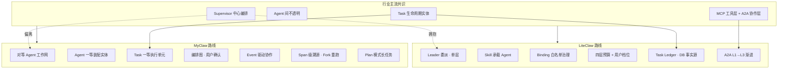

# MyClaw vs LiteClaw vs 行业主流 — 多智能体协作架构设计对比

> **对比范围**：仅比较架构设计思路与产品哲学，不涉及当前代码实现完成度。  
> **参考来源**：桌面文档 `liteclaw-a2a-industry-comparison.md`、LiteClaw A2A 设计文档、MyClaw `PRODUCT.md` / `TECH.md`。

---

## 1. 核心结论

| 维度 | 行业主流 | LiteClaw | MyClaw |
|------|---------|----------|--------|
| **协作范式** | Supervisor 中心编排 | 一致，且更保守（单层、无对等移交） | **刻意偏离**：对等 Agent 工作网，无主从 |
| **Agent 本体** | 各平台自有 Registry / Card | Skill 兼任 Agent 载体 | Agent 是一等实体，独立 CRUD + 版本化 |
| **协作触发** | Leader 动态委派 | 白名单 Binding + LLM 选 alias | 语义发现 + 图编排 + 事件订阅 |
| **执行单元** | Task 有生命周期 | Subagent Task + Durable Run | Task 是第一等公民，无「子 Agent」概念 |
| **互操作方向** | A2A 标准 | 分阶段对齐 A2A（L1→L3） | 内部协议，未纳入 A2A 路线 |
| **差异化强项** | — | 治理深度（Binding、分层预算、Task Ledger） | 装配灵活性、Span 级可观测与 Fork 重跑 |

**一句话**：LiteClaw 是「行业 Supervisor 范式的深度产品化」；MyClaw 是「企业 Agent 装配平台 + 对等协作工作网」，在协作拓扑上与行业默认答案**有意分道扬镳**。

---

## 2. 行业已收敛的架构共识

当前 Google A2A、Microsoft Agent Framework、LangGraph Swarm、CrewAI 等平台，在多智能体协同上已形成相近的默认答案：

1. **中心编排，而非对等协作** — 主 Agent 理解目标 → 拆分 → 委派专家 → 汇总；Swarm / Handoff 存在但非生产默认。
2. **Agent 之间不透明** — 只交换能力声明、任务状态、最终结果；不共享内部记忆与推理链。
3. **工具层与协作层分离** — MCP 管工具接入，A2A 管 Agent 互操作；两层互补。
4. **任务是有生命周期的实体** — 委派 ≠ 函数调用；任务有状态、进度、产物、可中断/恢复。
5. **先简单后复杂** — 单 Agent 能搞定就不上多 Agent；上了也优先 Supervisor。

LiteClaw **完全拥抱**上述共识；MyClaw 在 **第 1 条** 上做了反向选择。

---

## 3. 三方架构哲学概览

### 3.1 LiteClaw：Supervisor + Skill 载体 + 治理优先

```
用户
  └── Leader Agent（主对话 Agent）
        ├── Prompt Skills（能力注入，主 Agent 自用）
        └── Delegated Agent Skills（可委派下游）
              ├── Binding 白名单（管理员预绑 alias）
              ├── 隔离执行 + 紧凑终态回传
              └── Durable Task Ledger（DB 事件为事实源）
```

**设计信条**：
- 不另建重型 Agent Registry，复用 Skill 安装/同步/版本链路
- 委派权限「只减不增」：Binding 收窄候选集，LLM 动态选 alias
- 四层预算（Run → Leader → Delegation → Child）+ 用户档位（闪速/Pro/Ultra）
- A2A 对象模型对齐，协议分 L1/L2/L3 渐进落地

### 3.2 MyClaw：装配平台 + 对等 Agent 工作网

```
Admin 装配 Agent（独立实体、版本化、多模式）
  ├── Chat / Plan / Group 模式可并存
  └── Group 模式 → 加入 Agent 工作网
        ├── Capability Manifest（能力自描述）
        ├── Event Manifest（事件订阅）
        └── 运行时涌现协作拓扑（非预连线）

执行层以 Task 为核心：
  Agent A 的 Task ──invoke_agent──▶ Agent B 的 Task
  Agent C ──emit_event──▶ 事件总线 ──▶ Agent D 自动触发 Task
  多 Task 共享 session_id → 联合 Trace / 编排图可视化
```

**设计信条**：
- **灵活、干净、职责清晰** — Agent / Task / Session / Runner / Span 分层明确
- **无主从层级** — 不存在 Orchestrator/Worker 固定角色，图结构由运行时调用自然形成
- **Task 无子 Agent 概念** — 异步协作 = 同一 Agent 配置的独立运行时实例，通过 Task 依赖链协作
- **Span 级可观测 + Fork 重跑** — 每次 LLM 调用的完整快照可溯源、可编辑、可对比重跑
- **Plan 模式** — 用户确认结构化计划后再异步执行，适合长任务

---

## 4. 分维度深度对比

### 4.1 协作拓扑：谁指挥谁

| | 行业主流 | LiteClaw | MyClaw |
|---|---------|----------|--------|
| 基本形态 | 中心编排者 + 专家执行者 | Leader 委派 → 专家执行 → Leader 汇总 | **对等节点**，无固定 Leader |
| 并行 | Fan-out 独立子任务 | 支持，限定同类执行环境 | 编排图显式建模 parallel / join 边 |
| 流水线 | 部分平台一等能力 | 靠 Leader 多轮委派 | 编排图节点 + `depends_on` Task 链 |
| 对等移交 | Swarm / Handoff 可选 | **不支持**，必须经 Leader | **原生支持** `invoke_agent` 任意 Agent 互调 |
| 事件驱动 | 部分平台支持 | 非 A2A 第一阶段重点 | **一等原语** `emit_event` + Event Manifest |
| 递归深度 | 部分允许多层嵌套 | **明确单层** | `max_depth` 可配，允许有限递归 |
| 编排确认 | 多数自动执行 | Leader 自主决策 | **用户预览编排图**后可确认/拖拽修改 |

**同**：LiteClaw 与行业一致；MyClaw 与两者都不同。

**异（MyClaw 独特）**：
- 把「Agent 工作网」当作平台级拓扑，而非单次对话内的临时委派树
- 支持 Request-Response（主动咨询）与 Event/Notification（被动订阅）双原语
- 复杂协作走「发现 → 加载 Schema → 生成编排图 → 用户确认 → 驱动 Task」六步流程

**取舍**：
- LiteClaw：可控、可解释、符合 A2A 心智；复杂编排 latency 更高
- MyClaw：更贴近「多业务域 Agent 自治协作」；缺少统一汇总点，全局一致性靠 Task 依赖与 Session 共享保证

---

### 4.2 Agent 从哪来：注册与发现

| | 行业主流 | LiteClaw | MyClaw |
|---|---------|----------|--------|
| Agent 本体 | 独立 Registry / Agent Card | **Skill 包** + `delegatable=true` metadata | **独立 Agent 表**，完整装配配置 |
| 发现机制 | Card 自描述 + 注册中心 / 代码声明 | Leader 绑定的 Delegated Agent 列表 | `find_agents(capability_query)` 语义匹配 |
| 能力声明 | AgentSkill / capabilities | Skill metadata → 虚拟 AgentCard | **Capability Manifest** + **Event Manifest** |
| 分发 | 代码部署 / 容器 / 平台注册 | 复用 Skill 安装同步链路 | Admin UI 动态装配，版本快照 |
| 关系配置 | 代码或图配置 | **Binding**（运营者可配白名单） | 运行时涌现，不预配 Agent 间连线 |

**同**：三者都认可 Agent 需要自描述与被发现的机制。

**异**：
- LiteClaw 创新在 **Skill 即 Agent**，降低体系复杂度，与 code-first 框架心智不同
- MyClaw 创新在 **Agent 作为企业级装配蓝图**，Tool/Skill/MCP/Model/Channel 全在 UI 配置，Group 模式下靠 Manifest 对外广播能力

**取舍**：
- LiteClaw 适合「能力包分发 + 轻量委派」场景
- MyClaw 适合「企业内多团队各自装配 Agent、运行时互发现」场景

---

### 4.3 委派 / 协作决策：谁决定派给谁

| | 行业主流 | LiteClaw | MyClaw |
|---|---------|----------|--------|
| 决策主体 | LLM 动态决定 | LLM 从 Binding 白名单选 alias | LLM 语义发现 + 生成编排图 |
| 候选集 | 已声明 Agent 集合 | **管理员预绑**，模型不能扩权 | `[group]` 区块注入 + `find_agents` 扩展 |
| 路由 | 语义匹配或显式工具调用 | `task(agent=alias, ...)` | `invoke_agent(agent_id, task, context)` |
| 用户介入 | 少见 | 档位影响委派意愿 | **Plan/Group 模式用户确认计划/编排图** |
| 权限模型 | 框架侧不一 | Binding 只减不增 | Agent 级 built_in_tools 开关 + owner 隔离 |

**同**：委派/协作决策均由 LLM 在运行时动态做出，非写死流程。

**异**：
- LiteClaw 把「能派谁」与「派给谁」拆开 — 治理在 Binding，灵活在 LLM
- MyClaw 把「发现谁」与「如何协作」拆开 — 发现靠 Manifest，协作形态由编排图 + Task 依赖表达

---

### 4.4 通信、互操作与事实源

| | 行业主流 | LiteClaw | MyClaw |
|---|---------|----------|--------|
| 跨平台标准 | A2A 协议 | 对象模型对齐，L1→L3 渐进 | **未纳入 A2A**，内部 HTTP/WS |
| 内部通信 | 框架内存 / checkpoint | Durable Run + DB 事件 | Task 状态 + Span 树 + Redis 事件总线 |
| 断线恢复 | 流可断，状态可重建 | DB 为唯一事实源，刷新可恢复 Task Ledger | Celery 异步 Task + WS 推送 Span |
| 远程 Agent | A2A client/server | L2 Agent Card + HTTP adapter（规划中） | Agent API Token 外部 HTTP 调用 |
| Session 共享 | 各框架不一 | Leader/Child 独立 thread | **Group Task 共享 session_id** |

**同**：都认同任务状态应持久化、不应绑定浏览器连接生命周期。

**异**：
- LiteClaw 明确走 A2A 互操作路线，短期简化、长期 parity
- MyClaw 走 **平台内闭环**：Agent API Token 供外部系统调用单个 Agent，但 Agent 间协作是平台内部协议
- MyClaw 的 `session_id` 跨 Agent 共享是联合 Trace 的基础 — LiteClaw 更强调 Leader/Child 隔离

---

### 4.5 上下文与状态隔离

| | 行业主流 | LiteClaw | MyClaw |
|---|---------|----------|--------|
| 子 Agent 上下文 | 独立、干净 | 一致：不继承 Leader 完整人设 | 各 Agent 独立 AgentRuntime，独立系统提示词 |
| 信息回传 | 结果摘要或过滤对话 | **仅终态紧凑结果**进 Leader 上下文 | `invoke_agent` 返回结果注入调用方上下文 |
| 过程可见性 | 框架 tracing | 过程进 Task Ledger，**不进 Leader 推理链** | **AgentCallSpan 嵌套 Runner**，过程全量进 Trace |
| 不透明原则 | 不暴露内部推理 | 一致 | 协作 Agent 间不传 Span 细节，但平台 Trace 全可见 |
| Token 控制 | 各框架不一 | 严格回流控制防污染 | Context Strategy（sliding/summary/full）+ 压缩阈值 |

**同**：执行隔离、防上下文污染是共识。

**异**：
- LiteClaw 对 Leader 上下文保护更激进 — 子 Agent 过程与用户可见性分离
- MyClaw 对 **平台观测者** 更透明 — Span 树含 LLM 完整快照（system_prompt、messages、tools），支持 Fork 重跑；这是 MyClaw 的核心差异化

**取舍**：
- LiteClaw 优化「长对话 Leader 不被子 Agent 过程撑爆」
- MyClaw 优化「企业运维/调试/合规审计需要完整溯源」

---

### 4.6 能力扩展：Skill / Tool / Agent 边界

| | 行业主流 | LiteClaw | MyClaw |
|---|---------|----------|--------|
| 能力注入 | Prompt / 工具 / 插件 | **Prompt Skill** | **Skill**（提示词片段 → `[skills]` 区块） |
| 原子操作 | Function / Tool | Tool（经 skill middleware） | **Tool**（Python 函数，Tool Registry） |
| 外部服务 | MCP | MCP | **MCP Registry**（只注册连接，不托管进程） |
| 独立执行者 | 另一个 Agent | **Agent Skill**（delegatable skill） | **Agent 实体**（与 Skill 完全分离） |
| 概念区分 | 行业常混用 | **双轨强制分离** | **三轨分离**：Tool / Skill / Agent 各 Registry |
| 内置协作工具 | 框架各异 | `task` / `subagent_run` | `find_agents` / `invoke_agent` / `emit_event` / `create_task` 等 |

**异（LiteClaw 独有）**：Prompt Skill vs Agent Skill 双轨，配置入口分开，避免「注入 vs 委派」语义混乱。

**异（MyClaw 独有）**：Agent 不是 Skill 的变体，而是包含 Model、Prompt 区块、Tool/Skill/MCP 绑定、执行模式、Group Manifest 的 **完整装配体**；Skill 永远只是提示词增强，不具备独立执行生命周期。

---

### 4.7 预算、档位与防护

| | 行业主流 | LiteClaw | MyClaw |
|---|---------|----------|--------|
| 预算粒度 | iteration 上限 / timeout | **四层** + soft/hard + Leader reserve | Task 级 `max_cost_usd` |
| 用户档位 | 少见 | 闪速/Pro/Ultra 控制委派意愿与并行度 | 无用户档位设计 |
| 委派次数 | 粗粒度 | Delegation budget 独立计数 | `max_fanout` 限制扇出 |
| 调用深度 | 部分有限制 | **单层委派** | `max_depth` 可配 |
| 循环防护 | 部分有 | 单层天然限制 | 调用链深度追踪，检测循环拒绝 |
| 超时 | 常见 | Child timeout + hard cap | Task 级 `timeout` → auto cancel |

**异（LiteClaw 独有）**：把委派视为「独立执行单元」而非「高级工具调用」，因此需要 Run/Leader/Delegation/Child 四层预算 + 用户档位 — 这是 LiteClaw 相对行业最大的架构特色。

**异（MyClaw）**：防护偏 **图拓扑级**（depth/fanout/cycle/cost），未设计 Leader 资源预留或 soft partial result 语义。

---

### 4.8 可观测性

| | 行业主流 | LiteClaw | MyClaw |
|---|---------|----------|--------|
| 开发者视角 | Tracing / checkpoint | 持久化事件流 | **Span Tree**（LLM/Tool/Agent/Memory/Event） |
| 用户视角 | 多数不重点考虑 | **Task Ledger 一等公民** | Task 看板 + 编排图实时状态 + 渠道推送 |
| 跨 Agent 视图 | 部分支持 | Leader 看 Task Ledger | **共享 session_id 联合 Trace** + 调用图 + 时间线 |
| 重跑 | 少见 | 非重点 | **Fork Session + Span 级编辑重跑** |
| 快照粒度 | 请求级 | Task 事件级 | **LLM 调用级完整快照**（含 prompt/messages/tools） |
| 保留策略 | 各异 | Durable DB | `retention_days` + 多维度告警 |

**同**：任务有标准状态机，进度可流式展示。

**异**：
- LiteClaw 偏 **产品级任务账本** — 用户刷新不丢，子 Agent 进度可读
- MyClaw 偏 **工程级溯源与实验** — Span 快照 + Fork 重跑 + 新旧 Session 对比，适合 Agent 调优与合规

---

### 4.9 执行模式与异步策略

| | 行业主流 | LiteClaw | MyClaw |
|---|---------|----------|--------|
| 对话模式 | 主路径 | Durable Run 长任务 | **Chat 模式** ReAct |
| 计划模式 | 部分框架支持 | 非重点 | **Plan 模式**：生成计划 → 用户确认 → 异步逐步执行 |
| 协作模式 | Supervisor 委派 | A2A 委派 | **Group 模式**：工作网 + 编排图 |
| 异步 | Task 异步 | Durable Run 脱离浏览器 | **Task 第一等公民** + Celery Worker |
| 定时 / 事件 | 部分支持 | 非 A2A 重点 | `create_scheduled_task` + `emit_event` 触发 |
| 渠道推送 | 少见 | 非重点 | 多 Channel（微信/飞书/Telegram/Webhook） |

**异（MyClaw 独有）**：Chat / Plan / Group 三模式可并存于同一 Agent；异步 Task 与同步对话可并行 — 用户说「后台算 Q3 利润，8 点微信通知」时主对话不阻塞。

---

## 5. 一张总表

| 架构维度 | 行业主流 | LiteClaw | MyClaw |
|----------|---------|----------|--------|
| 协作拓扑 | Supervisor | Supervisor（更保守） | **对等 Agent 工作网** |
| Agent 载体 | 自有 Registry | Skill 即 Agent | 独立 Agent 实体 |
| 委派治理 | 动态委派 | Binding 白名单 | Manifest + 语义发现 |
| 互操作 | A2A | A2A 分阶段 | 平台内协议 + Agent API |
| 上下文隔离 | 一致 | 终态严格回流 | 独立 Runtime + 全量 Trace |
| 能力模型 | 常混用 | Prompt/Agent Skill 双轨 | Tool/Skill/Agent 三轨 |
| 预算体系 | 偏粗糙 | 四层 + 档位 | Task 级 cost/depth/fanout |
| 可观测性 | 偏开发侧 | Task Ledger（用户侧） | Span 快照 + Fork 重跑 |
| 编排方式 | Leader 驱动 | Leader 多轮委派 | LLM 生成图 + 用户确认 |
| 事件协作 | 部分 | 非重点 | Event Manifest + 事件总线 |
| MCP 定位 | 互补 A2A | 同样 | 同样 |

---

## 6. 架构路线对照：同路与分岔



---

## 7. 场景适配建议

| 场景 | 更契合 | 理由 |
|------|--------|------|
| 单入口对话 + 专家委派 + 长任务预算管控 | **LiteClaw** | Supervisor 范式 + 分层预算 + Task Ledger |
| 跨平台 / 跨组织 Agent 互操作（A2A） | **LiteClaw** | 明确 A2A 对齐路线 |
| Skill 包分发、轻量挂载可委派 Agent | **LiteClaw** | Skill 即 Agent，Binding 运营友好 |
| 企业多业务域 Agent 自治、对等协作 | **MyClaw** | Group 工作网 + Event 订阅 + 无 Leader 假设 |
| 复杂 DAG 并行编排 + 用户审批 | **MyClaw** | 编排图一等建模 + parallel/join |
| Agent 调优、合规审计、Span 级重跑 | **MyClaw** | LLM 完整快照 + Fork Session |
| 定时任务 / 多渠道异步推送 | **MyClaw** | Task + Channel + scheduled/event trigger |
| 快速对齐行业默认、降低协作模式争议 | **LiteClaw** | 与 Google/Microsoft 方向一致 |

---

## 8. 互相可借鉴的设计点

### LiteClaw → MyClaw 可借鉴

1. **Binding 白名单治理** — MyClaw Group 模式的 `find_agents` 语义发现灵活，但企业场景可能需要「可协作 Agent 白名单」约束。
2. **四层预算 + soft/hard** — MyClaw 仅有 Task 级 cost 上限，长 Group 编排缺少 Leader 资源预留与 partial result 语义。
3. **Prompt Skill / Agent Skill 双轨** — MyClaw Tool/Skill/Agent 已分离，但可显式标注「注入型 Skill」vs「可协作 Agent」的配置入口，降低运营混淆。
4. **Task Ledger 用户体验** — MyClaw Trace 偏工程侧，可补充面向业务用户的任务账本视图（刷新不丢、进度可读）。
5. **A2A 互操作路线** — 若 MyClaw 需对接外部 Agent 生态，Capability Manifest 可映射 AgentCard，Task 模型可映射 A2A Task。

### MyClaw → LiteClaw 可借鉴

1. **编排图显式建模** — parallel/join 边比 Leader 多轮委派更可预测、可预览。
2. **Event 驱动协作** — `emit_event` + Event Manifest 适合「完成即触发下游」的业务链，Supervisor 模型不易表达。
3. **Span 级 Fork 重跑** — 对 Agent 调优与 A/B 对比实验价值高。
4. **Plan 模式** — 长任务「先计划后执行 + 用户确认」与 LiteClaw 的 Leader 自主委派互补。
5. **Agent 完整装配体系** — Model Hub、Channel、Memory、Sandbox 等企业级配置，Skill 载体 Agent 可吸收为「Agent Skill 的 runtime spec 扩展」。

---

## 9. 架构评价

### LiteClaw

**对路**：Supervisor 主范式、A2A 对象模型、MCP/A2A 分层 — 与 Google、Microsoft、Anthropic 方向一致。

**有意不同**：Skill 承载 Agent、Binding 白名单、双轨 Skill、分层预算、协议渐进。

**需接受的代价**：复杂编排靠 Leader 多轮、无 Swarm/Handoff、远程互操作尚在 L2。

### MyClaw

**对路**：Task 生命周期、Agent 不透明协作（互调时不传 Span 细节）、MCP 工具层分离、异步优先 — 与行业部分共识一致。

**有意不同**：对等 Agent 工作网（反 Supervisor 默认）、Agent 一等实体、Span 级全量溯源、编排图用户确认、Event 驱动。

**需接受的代价**：
- 与 A2A/Supervisor 生态心智不一致，跨平台互操作需额外适配层
- 缺少统一 Leader 汇总点，全局任务一致性依赖 Session/Task 依赖设计
- 全量 Span 快照带来存储与 token 成本，需 retention 与压缩策略
- 分层预算与用户档位未设计，长 Group 编排的资源管控偏粗

---

## 10. 一句话总结

- **LiteClaw**：在行业公认的 **Supervisor + A2A** 范式上，用 Skill 统一分发、Binding 管住委派、分层预算撑住长任务 — **方向对，特色在治理深度**。
- **MyClaw**：在 **Agent 装配平台** 基础上，选择 **对等 Agent 工作网** 而非中心编排 — **方向不同，特色在装配灵活性、图编排与 Span 级可观测**。
- **二者关系**：不是谁替代谁，而是 **LiteClaw 贴近行业默认的生产委派模型，MyClaw 探索企业多 Agent 自治协作的另一种拓扑**；若未来融合，MyClaw 的 Group 工作网可在单个 Agent 内部退化为 LiteClaw 式 Leader 委派，或 MyClaw 引入 Binding/A2A 以对接外部生态。

---

*文档生成日期：2026-07-13*
