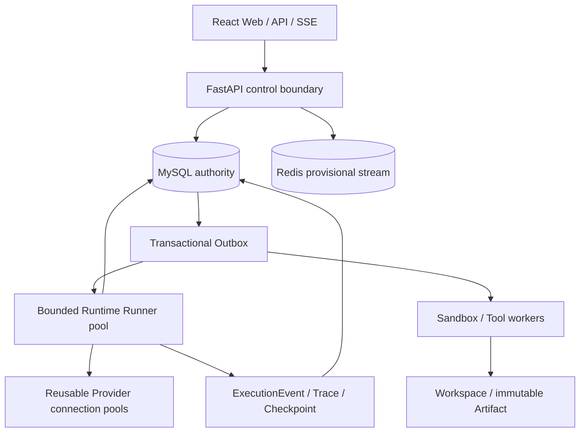

# MyClaw

MyClaw is an Agent-native platform for durable chat, plan-first execution, Tool use, and emergent multi-Agent collaboration.

它不是固定工作流编排器，也不为每个 Agent 启动常驻服务。Agent 是可版本化的逻辑工作主体；任务到达后，Runtime Worker 才按需领取持久化 Runner，并通过统一 Agent Loop 推进工作。

> **Release status:** `v0.1.0` is a single-machine/UAT release for development and architectural evaluation. The repository contains a production reference architecture, but the local Compose profile is not a production security or HA profile.

## Why MyClaw

- **One Agent Loop:** Chat、Plan和Group共享同一模型—Tool—观察—继续循环。
- **Durable execution:** Run、WorkItem、Runner、Checkpoint、Outbox、lease和fencing让等待与Worker重启可恢复。
- **Emergent Groups:** 正常Chat后，模型根据完整的受治理Agent `name/description`目录选择最小必要成员，再形成Group。
- **Asynchronous handoff:** Group成员通过定向、human-visible的`@请求`和`@交付`协作，不同步阻塞上游Agent。
- **Governed actions:** CapabilitySnapshot、Approval、ToolInvocation、Sandbox和Artifact把模型意图转换成可审计行动。
- **Evidence over claims:** Tool结果、测试、checksum、Artifact和Verification与模型文字声明分离。

## Group model

```mermaid
sequenceDiagram
    actor User
    participant Recovery as Recovery (chat anchor)
    participant Evidence
    participant Security

    User->>Recovery: Review the incident and recovery plan
    Recovery->>Recovery: Select the smallest useful Group from governed Agent cards
    Recovery-->>User: Group formed; primary work handed to Evidence
    Recovery->>Evidence: Directed @ request (async handoff)
    Evidence->>Evidence: Perform evidence review
    Evidence->>Security: Directed @ request for security verification
    Security->>Evidence: Directed @ delivery
    Evidence->>Recovery: Directed @ delivery
    Recovery-->>User: Final Group summary with evidence and disagreements
```

Group messages are not a hidden broadcast bus. A directed message wakes only its recipient; concise Group-visible notes remain searchable history and do not automatically enter every member's prompt.

## Architecture



## Quick start

### Requirements

- Docker with Compose v2
- GNU Make
- About 8 GB of available memory is recommended when all optional workers are enabled

### Start the core local stack

Clone this repository with the HTTPS or SSH URL shown by GitHub, then run:

```bash
cd myclaw
make up
```

`make up` creates a Git-ignored `.env` with random local secrets on first use, builds the core services, and starts:

- Web UI: <http://localhost:8080>
- API and OpenAPI: <http://localhost:8000/docs>
- API health: <http://localhost:8000/health>

The bootstrap administrator credentials are stored only in the local `.env`:

```bash
grep '^INIT_ADMIN_' .env
```

The default stack is explicitly a local `development` profile. Do not expose it directly to an untrusted network.

### Configure a model

After signing in:

1. Open model administration.
2. Create a ModelVersion for `openai`, `openai_compatible`, `azure_openai`, `ollama`, or `anthropic`.
3. Submit the endpoint, model name, and API key through the write-only credential field.
4. Run Provider conformance and activate the passing version.
5. Create and publish an AgentVersion using that model.

Release and acceptance rules are documented in [`docs/VALIDATION.md`](docs/VALIDATION.md). Raw UAT evidence, credentials, environment metadata, backups, and user workspaces remain outside Git.

### Useful commands

```bash
make help             # list commands
make status           # show local services
make logs             # follow core logs
make test             # backend unit tests + frontend production build
make release-check    # public-release safety and reproducibility gate
make down             # stop services, preserve volumes
make reset            # remove local containers and volumes (destructive)
```

Optional Browser and connector workers can be started with:

```bash
make up-all
```

## Reproduce the emergent Group demo

[`docs/demo/emergent-group.md`](docs/demo/emergent-group.md) contains the Agent cards, setup checklist, prompt, expected handoff semantics, and audit queries for a three-Agent Recovery/Evidence/Security demonstration.

The demo intentionally does not prescribe a fixed collaboration graph. Agent names and descriptions are provided as governed data; the model chooses members and each member decides whether another specialist is needed.

## Tests

Create the local test environment once:

```bash
make test-env
```

Then run deterministic tests:

```bash
make test
```

Real-model full-stack acceptance requires explicit Provider credentials and controlled evidence handling. See [`docs/VALIDATION.md`](docs/VALIDATION.md) and [`test/README.md`](test/README.md). CI never uses a surrogate model to claim Agent behavior passed.

## Project maturity

| Area | v0.1.0 status |
| --- | --- |
| Durable Runtime, Outbox, lease/fencing | Implemented and unit tested |
| Chat / Plan / Group unified loop | Implemented; real-model behavior requires UAT |
| Emergent Group and async handoff | Implemented; active stabilization focus |
| Tool, Skill, Browser, MCP, Artifact | Implemented in the local/UAT profile |
| Local Workspace and Sandbox | Development/UAT only; not strong untrusted-code isolation |
| Multi-tenant SaaS, OIDC/OBO/SCIM | Designed, not implemented as a production profile |
| Kubernetes, multi-AZ, committed SLO/RPO/RTO | Reference architecture only |

See [`PRODUCT.md`](PRODUCT.md) for product semantics, [`TECH.md`](TECH.md) for target architecture, and [`docs/README.md`](docs/README.md) for the authoritative documentation map.

## Contributing and security

- Contribution guide: [`CONTRIBUTING.md`](CONTRIBUTING.md)
- Security policy and current trust boundaries: [`SECURITY.md`](SECURITY.md)
- Code of conduct: [`CODE_OF_CONDUCT.md`](CODE_OF_CONDUCT.md)
- Changelog: [`CHANGELOG.md`](CHANGELOG.md)

Never commit Provider keys, deployment `.env` files, UAT evidence, database backups, or user workspaces. Run `make check-secrets` before opening a pull request.

## License

Licensed under the [Apache License 2.0](LICENSE).
